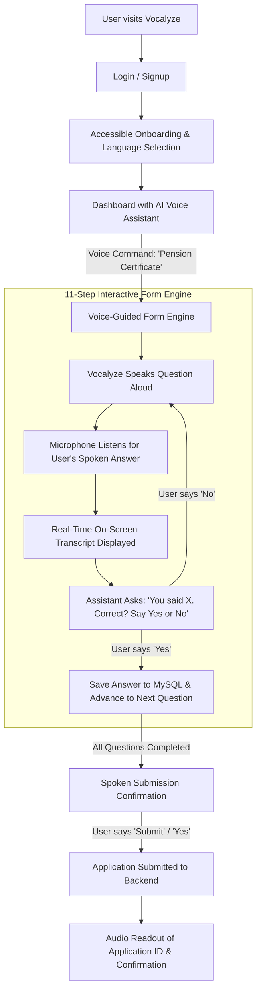

# 🎙️ Vocalyze — Digital Access for Everyone

<div align="center">
  
  
  <h3>Empowering Visually Impaired, Elderly &amp; Multilingual Citizens with AI-Powered Voice Navigation and Accessible Public Services</h3>

  <p>
    <a href="#-key-features">Features</a> •
    <a href="#-tech-stack">Tech Stack</a> •
    <a href="#-architecture--workflow">Architecture</a> •
    <a href="#-getting-started">Getting Started</a> •
    <a href="#-mysql-database-setup">Database Setup</a> •
    <a href="#-api-documentation">API Reference</a> •
    <a href="#-voice-assistant-commands">Voice Guide</a>
  </p>
</div>

---

## 🌟 Overview

**Vocalyze** is an assistive AI-driven digital governance platform designed to make essential public services (such as **Pension Certificates**, **Disability UDID Certificates**, and **Income Certificates**) completely accessible to everyone.

By combining **Web Speech Recognition**, **Real-time Neural Speech Synthesis**, **Multilingual NLP**, and **Computer Vision OCR**, Vocalyze enables blind, low-vision, illiterate, and motor-impaired individuals to interact with digital forms entirely hands-free using natural voice in their native language (**English**, **हिंदी (Hindi)**, and **ಕನ್ನಡ (Kannada)**).

---

## 🚀 Key Features

### 1. 🗣️ Hands-Free AI Voice Assistant
- **Automatic Spoken Greeting**: Welcomes the user by name upon logging into the dashboard.
- **Voice Service Discovery**: Narrates available government schemes and applications aloud.
- **Voice Selection**: Directs the user to the appropriate application form purely through spoken voice (e.g. *"Apply for Pension Certificate"* or *"ಪಿಂಚಣಿ ಪ್ರಮಾಣಪತ್ರ"*).

### 2. 📝 Interactive Voice-Guided Form Filling
- **Step-by-Step Question Narration**: Speaks every form question aloud at a crisp, natural conversational pace.
- **Continuous Speech Recognition**: Allows natural speaking with intelligent silence debouncing (1.8s timeout) to capture multi-digit numbers (12-digit Aadhaar, 10-digit phone, PPO numbers) without premature cutoffs.
- **Real-Time On-Screen Transcript**: Displays live speech words and extracted values in high contrast as you speak.
- **Instant Yes/No Voice Confirmation**: Prompts confirmation (*"You said: 123456. Correct? Say Yes or No"*), executing instantly with zero delay on affirmative (*"Yes"*, *"Haan"*, *"Haudu"*, *"Correct"*) or negative responses.
- **Direct Spoken Corrections**: If you speak a correction (e.g. changing *"Male"* to *"Female"*), the assistant immediately updates the value and re-confirms.

### 3. 📄 AI Document OCR & Scanner
- **Camera Scanner / File Upload**: Scan physical identity documents (e.g. Aadhaar cards, pension orders).
- **Deterministic & Gemini AI Extraction**: Automatically parses names, dates of birth, genders, and identification numbers from images, auto-filling the form questions instantly.

### 4. 🌐 Multilingual Accessibility
- Full native UI and voice support in **English**, **हिंदी (Hindi)**, and **ಕನ್ನಡ (Kannada)**.
- High-legibility typography with **Plus Jakarta Sans**, **Inter**, **Outfit**, and localized **Noto Sans** scripts.

### 5. ♿ Accessibility Customization
- **High Contrast Dark/Light Modes**: WCAG AAA compliant color contrasts (`#092d2c` deep forest background, `#d9f560` electric lime accents).
- **Scalable Font Sizing**: User-selectable text scale (Standard, Large, Extra Large).
- **Screen Reader Compatibility**: Semantic HTML5 elements and ARIA live regions.

---

## 🛠️ Tech Stack

### Frontend
- **Framework**: [React 18](https://react.dev/) + [Vite](https://vitejs.dev/)
- **Routing**: [React Router v6](https://reactrouter.com/)
- **Voice & Speech**: Web Speech API (`SpeechSynthesisUtterance` & `webkitSpeechRecognition`)
- **Document OCR**: [Tesseract.js](https://tesseract.projectnaptha.com/)
- **Styling**: Custom CSS Design System with Vanilla CSS & Glassmorphic tokens
- **Typography**: Google Fonts (*Plus Jakarta Sans*, *Outfit*, *Inter*, *Noto Sans Kannada*, *Noto Sans Devanagari*)

### Backend
- **Runtime**: [Node.js](https://nodejs.org/) & [Express](https://expressjs.com/)
- **AI & NLP**: [Google Gemini API](https://ai.google.dev/) (`@google/generative-ai`)
- **Database**: **[MySQL 8.0+](https://www.mysql.com/)** via **[MySQL Workbench](https://www.mysql.com/products/workbench/)** + [`mysql2`](https://www.npmjs.com/package/mysql2) driver
- **Authentication**: Custom password hashing (PBKDF2-SHA512 via Node.js `crypto`) + **JSON Web Tokens (JWT)**
- **Security & Utilities**: CORS, dotenv

> **Note:** This project uses **MySQL only** — Firebase/Firestore has been fully removed. All user accounts, application records, and service definitions are stored in a local MySQL Workbench database.

---

## 🏗️ Architecture & Workflow



### Database Architecture (MySQL)

```
users
  ├── uid (UUID v4, PK)
  ├── name, email, password_hash, password_salt
  ├── preferred_language (en/hi/kn)
  ├── accessibility_needs (JSON array)
  └── interaction_preferences (JSON object)

services
  ├── service_id (slug, e.g. 'pension-certificate')
  ├── name_en, name_hi, name_kn
  ├── description_en, description_hi, description_kn
  ├── category, enabled
  └── questions (JSON array of question objects)

applications
  ├── application_id (e.g. APP-2026-82341)
  ├── service_id → services.service_id
  ├── user_uid → users.uid
  ├── status (IN_PROGRESS / SUBMITTED / APPROVED / REJECTED)
  └── answers (JSON map: { fieldKey: "value" })
```

---

## 💻 Getting Started

### Prerequisites
- **Node.js**: v18.0.0 or higher
- **npm**: v9.0.0 or higher
- **MySQL Server**: v8.0+ (via [MySQL Workbench](https://www.mysql.com/products/workbench/))
- **Google Gemini API Key**: From [Google AI Studio](https://aistudio.google.com/)

---

### 1. Clone the Repository
```bash
git clone https://github.com/v152005/Vocalyze_db.git
cd Vocalyze_db
```

---

## 🗄️ MySQL Database Setup

### Step 1 — Install MySQL & MySQL Workbench
1. Download and install **[MySQL Community Server 8.0+](https://dev.mysql.com/downloads/mysql/)**.
2. Download and install **[MySQL Workbench](https://dev.mysql.com/downloads/workbench/)**.
3. Open MySQL Workbench and connect to your local MySQL instance (default: `root@localhost:3306`).

### Step 2 — Run the Schema Script
In MySQL Workbench:
1. Open **File → Open SQL Script** and select `config/schema.sql` from this project.
2. Click **Execute** (lightning bolt icon ⚡) to create the database, all tables, and seed the three default services.

Alternatively run from the terminal:
```bash
mysql -u root -p < config/schema.sql
```

This creates:
| Table | Purpose |
|:---|:---|
| `users` | User accounts with PBKDF2 password hashes and accessibility profile |
| `services` | Government service definitions (Pension, Disability, Income) with multilingual labels stored as JSON |
| `applications` | Application submissions with form answers stored as JSON |

### Step 3 — Configure Environment Variables
Create a `.env` file in the project root:
```env
# ---- MySQL (MySQL Workbench / Local Server) ----
DB_HOST=localhost
DB_PORT=3306
DB_USER=root
DB_PASSWORD=your_mysql_root_password
DB_NAME=dbms_project

# ---- Server ----
PORT=5000
NODE_ENV=development

# ---- JWT (use a strong random secret) ----
JWT_SECRET=your_strong_jwt_secret_here

# ---- Gemini AI ----
GEMINI_API_KEY=your_gemini_api_key_here
```

> ⚠️ **Never commit your `.env` file.** It is listed in `.gitignore`.

---

### 4. Backend Setup
```bash
# Install backend dependencies
npm install

# Start the development server (with hot reload)
npm run dev
```
*Backend will run on `http://localhost:5000`.*

---

### 5. Frontend Setup
```bash
cd client
npm install
npm run dev
```
*Frontend will run on `http://localhost:3000`.*

---

### 6. Run Both Simultaneously
```bash
# From the root directory:
npm run dev:all
```
This starts both the Express backend (port 5000) and the Vite frontend (port 3000) concurrently.

---

## 📡 API Documentation

### Authentication & Profile
| Method | Endpoint | Auth | Description |
| :--- | :--- | :--- | :--- |
| `POST` | `/api/users/signup` | None | Register a new user (creates MySQL row, returns JWT) |
| `POST` | `/api/users/login` | None | Login with email/password, returns JWT |
| `GET` | `/api/profile` | Bearer JWT | Retrieve user profile & accessibility preferences |
| `POST` | `/api/profile` | Bearer JWT | Update preferred language, text size & interaction needs |

### Government Services
| Method | Endpoint | Auth | Description |
| :--- | :--- | :--- | :--- |
| `GET` | `/api/services` | Bearer JWT | List all available public services |
| `GET` | `/api/services/:id` | Bearer JWT | Get question schema for a specific service |
| `POST` | `/api/services/seed` | Bearer JWT | Seed default services (Pension, Disability, Income) |

### Applications
| Method | Endpoint | Auth | Description |
| :--- | :--- | :--- | :--- |
| `POST` | `/api/applications` | Bearer JWT | Initialize a new application draft |
| `GET` | `/api/applications/:id` | Bearer JWT | Get application details and saved answers |
| `PATCH` | `/api/applications/:id` | Bearer JWT | Update answers for specific question fields |
| `POST` | `/api/applications/:id/submit` | Bearer JWT | Finalize and submit the application |
| `GET` | `/api/applications/user/me` | Bearer JWT | List all applications filed by current user |

### AI NLP & OCR Parsing
| Method | Endpoint | Auth | Description |
| :--- | :--- | :--- | :--- |
| `POST` | `/api/ai/parse-response` | Bearer JWT | Extract structured values from spoken conversational voice |
| `POST` | `/api/ai/parse-document` | Bearer JWT | Extract fields from OCR scanned image text |

---

## 🎙️ Voice Assistant Commands

| Intent | Spoken Keywords (English / Hindi / Kannada) |
| :--- | :--- |
| **Apply for Pension** | *"Pension"*, *"Pension Certificate"*, *"पेंशन"*, *"ವೃದ್ಧಾಪ್ಯ"*, *"ಪಿಂಚಣಿ"* |
| **Apply for Disability** | *"Disability"*, *"UDID"*, *"दिव्यांगता"*, *"ವಿಕಲಾಂಗತಾ"* |
| **Apply for Income Certificate** | *"Income"*, *"Income Certificate"*, *"आय प्रमाण पत्र"*, *"ಆದಾಯ ಪ್ರಮಾಣಪತ್ರ"* |
| **Affirmative / Confirm** | *"Yes"*, *"Correct"*, *"Confirm"*, *"Haan"*, *"Haudu"*, *"Sari"*, *"हाँ"*, *"ಹೌದು"* |
| **Negative / Retry** | *"No"*, *"Wrong"*, *"Change"*, *"Nahi"*, *"Illa"*, *"नहीं"*, *"ಇಲ್ಲ"* |
| **Submit Form** | *"Submit"*, *"Yes submit"*, *"Apply now"*, *"सबमिट"*, *"ಸಲ್ಲಿಸಿ"* |
| **View Applications** | *"My applications"*, *"Status"*, *"ಅರ್ಜಿಗಳು"*, *"आवेदन"* |
| **Logout** | *"Logout"*, *"Sign out"*, *"Exit"*, *"ಲಾಗ್ ಔಟ್"* |

---

## 👥 Authors & Acknowledgments

- **Team Vocalyze** — Built with ❤️ for inclusive, accessible, and barrier-free digital governance.
- **GitHub Repository**: [v152005/Vocalyze_db](https://github.com/v152005/Vocalyze_db)
- **Database**: MySQL 8.0 + MySQL Workbench (as required by course project guidelines)
